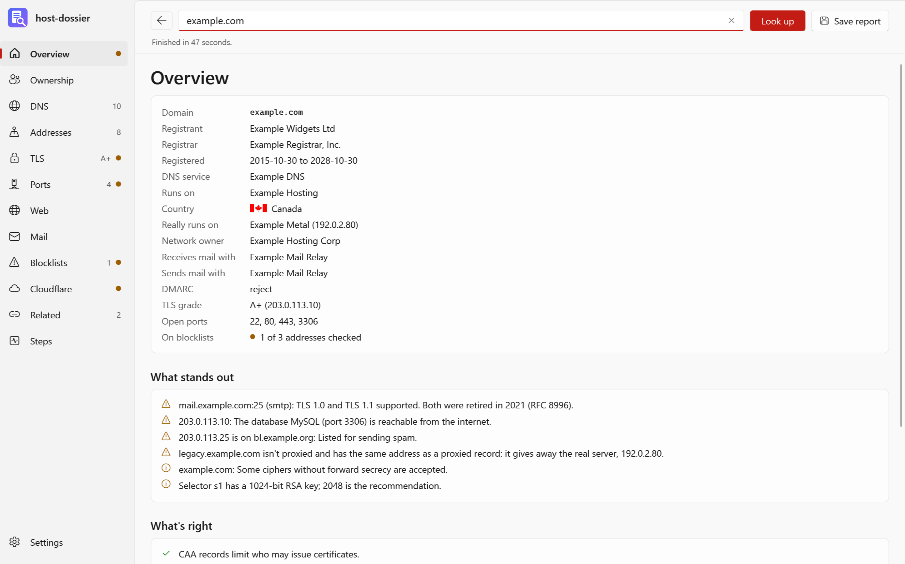
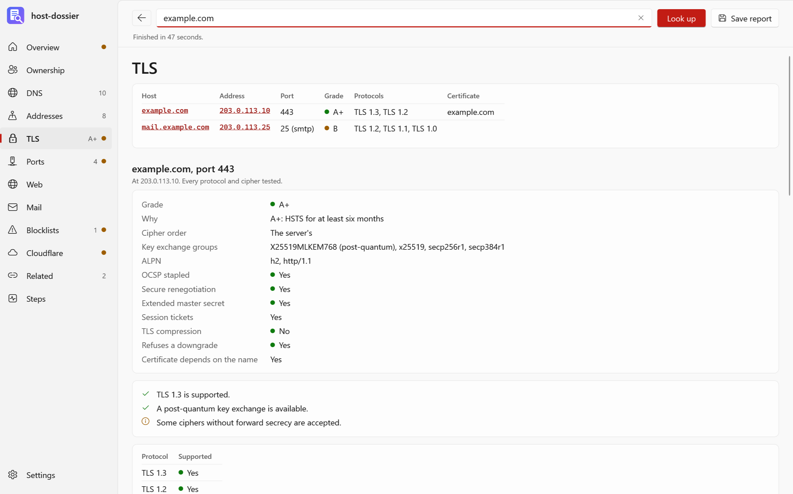
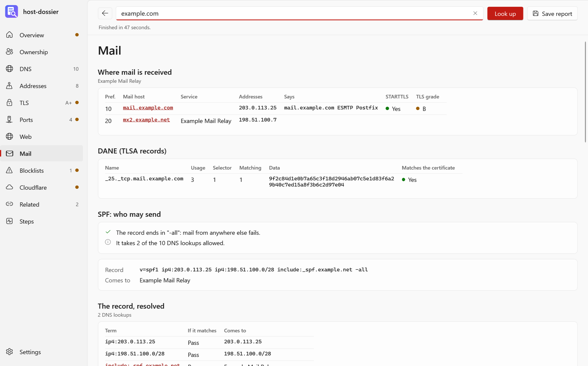

<p align="center">
  <a href="https://strongthium.com" title="Strongthium Labs"></a>
</p>

# host-dossier

[](https://github.com/strongthium/host-dossier/actions/workflows/release.yml)
[](https://github.com/strongthium/host-dossier/releases/latest)
[](LICENSE)

`host-dossier` is a research tool for finding out what's behind a domain or an IP address. Enter one, and it finds who
registered it and who holds its network, every DNS record, where each address really is, how its TLS is set up, which
ports answer and what's listening on them, and how its mail is set up, down to every address its SPF record allows and
whether those are on blocklists. Then it follows the other domains it found along the way.

It's a program with a window for Windows 10 and 11, and a command line for Windows and Linux.

**In short:** domain and IP lookup, WHOIS and RDAP lookup, DNS records and DNSSEC, SSL/TLS test (protocols, ciphers,
certificates), port scanner with banner grabbing, ASN, GeoIP country and reverse DNS (rDNS) lookup, SPF, DKIM, DMARC, BIMI
and VMC, MTA-STS and DANE checks, RBL and DNSBL blacklist checks, and Cloudflare origin IPs.



The pictures are of made-up sample data (`host-dossier --sample`).

## What it finds

| Page | What's on it |
|---|---|
| **Overview** | Who and where in a few lines, what stands out and what's right, across every other page |
| **Ownership** | The domain's registrar, dates, status and contacts, from RDAP and WHOIS (followed through the registry to the registrar), and who holds each address block, with its abuse contact |
| **DNS** | A, AAAA, CNAME, NS, SOA, MX, TXT, CAA, DS, DNSKEY, SRV, NAPTR, TLSA, SSHFP, URI, HTTPS and SVCB, and DNSSEC. Names under the domain, from common names, the public certificate logs (crt.sh), and a Cloudflare zone |
| **Addresses** | Every address found, with its service, AS number and name, routed prefix, country with its flag, reverse name (and whether that leads back), and why it's in the report |
| **TLS** | Each protocol from SSL 2.0 to TLS 1.3 and each cipher, the way SSL Labs tests them. Key exchange groups (post-quantum included), the certificate and its chain, and a grade |
| **Ports** | Which TCP ports are open, and what's listening, by what it says about itself |
| **Web** | Redirects, the title, the server, the response headers, HSTS |
| **Mail** | MX hosts and what they say on port 25, DANE, SPF resolved in full, DKIM, DMARC, BIMI and its certificate, MTA-STS, TLS-RPT |
| **Blocklists** | Every mail address against the DNS blocklists you choose |
| **Cloudflare** | With your API token, the zone's records as stored: the real addresses behind Cloudflare, and who each is on |
| **Related** | The other domains found, each with a short look of its own. Any domain or address in the report is a link that looks it up in turn |
| **Steps** | What was done, and what failed and why |

An IP address gets the same: its network and owner, its reverse name, TLS and ports. The domain behind it, from its
reverse name or its certificate, then gets its registration and mail looked up too.

## TLS



Windows and .NET won't offer old protocols or chosen ciphers, so the hellos are written byte by byte. Each protocol is
asked for by name. Then all of its ciphers are offered, the one the server chooses is taken away, and that's repeated
until it refuses. It's the method of SSL Labs, testssl.sh and sslyze. Nearly every probe ends after the server's hello.

The **grade** is this program's own, by rules modelled on SSL Labs' guide. It isn't their rating, and everything that
holds it down is listed beside it. Not tested, since testing them means attempting the attack: Heartbleed (only whether the
heartbeat extension is on is reported), ROBOT and renegotiation denial of service.

The name's first two addresses get the thorough test, and `www` gets a quick one if it's elsewhere. So do TLS ports found by
the port scan and mail hosts' STARTTLS: each protocol, its choice of cipher, and whether a bad one is accepted, in a few
connections.

## Mail



**SPF** is read by RFC 7208 and resolved all the way down: every `include` and `redirect`, every `a` and `mx` to its
addresses, into the list of networks allowed to send. Qualifiers carry through, so `-ip4:` is listed but not allowed. It
counts the ten-lookup limit and void lookups, and carries on past them to show what the record lists. `ptr`, `exists`
and macros that depend on the sender have no list to show, and are reported as such.

**The record, resolved** shows this as a tree, term by term, down to **each address** with its service, AS, country with its
flag, reverse name, and whether it's on a blocklist. An address inside an `include` inside an `include` gets the same as one in the
record itself. Networks of up to 1,024 addresses are listed whole. A network too big for that (Google's are `/16`s, and IPv6 ones are
vast) can't be: it gets the AS and country of all of it, by walking the prefixes it's routed as, and reverse names for a **sample**
of 8 addresses spread across it. The report says how many of how many.

In all, 4,096 addresses get looked up and 400 get checked against the blocklists: the domain's own networks first, then the
smallest. Reverse lookups get 90 seconds, and an address that ran out of time says so. All of these are in Settings, at the cost of time
and of queries the lists may object to.

**DKIM** keys can't be listed: the DNS has no way to ask. About 60 common selectors are tried, and Settings can add more. Finding
none doesn't mean there are none.

**BIMI**: the record, the DMARC policy it needs, the logo against the SVG Tiny PS rules, and a mark certificate's kind
(VMC or CMC), domain, dates and chain, and that the logo inside the certificate is the one published. Mark certificates' roots
aren't in Windows' store, so the chain is followed up to its root and that root is checked against the known issuers by name.

## Blocklists

A list is tried on its test addresses before it's believed (RFC 5782): one that's out of service can answer "listed" for
everything, and one that refuses your DNS server answers with a code that looks like a listing. Lists that fail this are left out
and say why. Listings that are only a policy (Spamhaus' PBL, SPFBL's "no mail service here") aren't reported as abuse.

Many lists refuse the big public DNS servers, so each list is asked through whichever works: the public servers first, then the
computer's own. **Spamhaus** refuses both if your own DNS server forwards to a public one. It then needs a DNS server that does
its own resolving, or their free [Data Query Service](https://www.spamhaus.com/product/data-query-service/), whose zone can be added in Settings.
All blocklist checks together get 60 seconds; what doesn't answer in time is reported.

## Cloudflare

In Settings, add an [API token](https://dash.cloudflare.com/profile/api-tokens) with Zone Read and DNS Read. A lookup of a zone it
can see then reads the records as stored, so a proxied record shows the real address, and each gets its network, country and
reverse name. The real server for the name gets a port scan and a TLS test. The report says when something public gives the real
address away: an unproxied record on the same address, the MX record, or SPF.

Tokens are encrypted for your Windows user (DPAPI), and go only to `api.cloudflare.com`. The command line takes one from the
environment variable `CLOUDFLARE_API_TOKEN`. Tokens never go in a report, but the real addresses do, and saving such a report asks first.

## History and saved reports

The last report of everything looked up is kept, and **History** lists them. Looking something up again within 24 hours shows the kept
report straight away, and says how old it is; **Look up again** brings it up to date, as does asking again for what's on the screen.
A lookup that was stopped isn't kept. Settings change the 24 hours, or stop reports being kept. **Clear the history** deletes them all.

**Save report** writes a file, and **Open** reads one back, with every page as it was and nothing looked up. Save as JSON for that;
Markdown is for reading and sharing.

## Using it

Download a zip from [Releases](../../releases/latest), or take a file straight from [`public/`](public), which always holds the
latest build:

| File | Needs |
|---|---|
| `host-dossier-win-x64-needs-dotnet.exe` | the window, for Windows 10 and 11: the [.NET 10 Desktop Runtime](https://dotnet.microsoft.com/download/dotnet/10.0) |
| `host-dossier-cli-win-x64-needs-dotnet.exe` | the command line, for Windows: the .NET 10 Runtime |
| `host-dossier-cli-linux-x64-needs-dotnet` | the command line, for Linux: the .NET 10 Runtime |

```
host-dossier example.com                 # looks it up straight away
host-dossier --open report.json          # a saved report, nothing looked up
host-dossier --sample --view mail        # a made-up report; also --theme light or dark

host-dossier-cli example.com             # a Markdown report on the screen
host-dossier-cli 192.0.2.1 --json --out report.json
host-dossier-cli example.com --skip ports --depth 1
host-dossier-cli example.com --only mail,blocklists --resolver system
host-dossier-cli example.com --cache     # the kept report if it's under 24 hours old, and keeps the new one
host-dossier-cli --open report.json      # a saved report as Markdown, or --json
host-dossier-cli --about                 # who makes this, and whether there's a newer version
host-dossier-cli --update                # installs the newer version: it asks first, unless --yes is given
```

The sample uses only the addresses, AS numbers and names set aside for documentation (`192.0.2.0/24`, `198.51.100.0/24`,
`203.0.113.0/24`, `2001:db8::/32`, AS64496 to AS64511, `example.com`, `.net` and `.org`).

### Only scan what you may

A lookup connects to the server it's looking up, and the port scan tries each port on the list, about 110 by default. That's
ordinary and quiet by the standards of scanners, but it's still a port scan: on some networks it's against the terms of service, and
in some places against the law without permission, and intrusion detection may notice and block you. Scan your own servers and
those you have permission for. **Port scan** in Settings or `--skip ports` turns it off. Addresses on content networks like
Cloudflare aren't scanned unless you ask, since their ports answer for the network, not the site.

## About and updates

**About** (at the bottom of the side) says who makes `host-dossier`, with links to Strongthium, and asks GitHub whether there's a newer version. If there is, **Update** downloads the release, checks it against the release's `SHA256SUMS`, replaces the program and starts it again. Reports and settings are kept in their own folder, and stay as they are. If the program's folder can't be changed without an administrator, it says so, and **What's new** leads to the release to download by hand. The checksums come with the release, so they catch a damaged download, not a tampered release.

GitHub is asked only when About is opened, again if it's still open an hour later, or when **Check again** is pressed. `api.github.com` sees that the question came from your address, and which program and version asked.

`host-dossier-cli --about` says the same and offers to update when someone is there to answer; `--update` installs the newer version, asking first unless `--yes` is given. The command line is one program and the window another: each updates itself.

## What's sent where

| To | What |
|---|---|
| The server being looked up | TLS hellos, the port scan, a web request, SMTP as far as `EHLO` |
| `1.1.1.1` and `8.8.8.8` | DNS queries, by default. Public servers show what the rest of the internet sees, and a home or office DNS server can be slow or lose long records. Settings or `--resolver` change this; leaving it empty uses the computer's own |
| This computer's DNS server | Blocklist queries that the public servers can't make |
| Team Cymru, by DNS | Each address, for its AS, prefix and country |
| IANA, the registries, registrars | The domain or address, for RDAP and WHOIS |
| crt.sh | The domain, for the certificate logs |
| The blocklists, by DNS | Each mail address |
| `api.cloudflare.com` | Your token, only if you've given one |
| `api.github.com` | The question of what the latest version is, only from About, `--about` or `--update` |

The country comes from the registry, for the block as a whole: where it's registered, not necessarily where the machine is. Settings
and kept reports are in `%LocalAppData%\Strongthium\host-dossier`, and go nowhere from there. Kept reports include the real addresses behind
Cloudflare, if a token showed them, and never the token.

## Building

You need Windows and the [.NET 10 SDK](https://dotnet.microsoft.com/download).

```
.\build.ps1                 # tests, then the programs into public\  (or double-click build.cmd)
.\build.ps1 -Bump revision  # the same as a new version: 1.0.0.0 -> 1.0.0.1
```

`build.ps1` runs the tests (`-SkipTests` skips them), publishes the programs, and replaces what's in [`public/`](public) with them,
their `SHA256SUMS` and the `VERSION` they were built as.

For working on it:

```
dotnet build
dotnet test
dotnet run --project src/HostDossier -- --sample
dotnet run --project src/HostDossier.Cli -- example.com --skip ports
```

| Folder | What's in it |
|---|---|
| [`src/HostDossier.Core`](src/HostDossier.Core) | everything that isn't a window: DNS, RDAP and WHOIS, networks, the TLS scanner, the port scanner, the mail checks, blocklists, Cloudflare, the lookup that ties them together, and the report made from it |
| [`src/HostDossier`](src/HostDossier) | the window (WPF, with its Fluent theme), which draws the report's pages, and the settings |
| [`src/HostDossier.Cli`](src/HostDossier.Cli) | the command line |
| [`tests/HostDossier.Tests`](tests/HostDossier.Tests) | tests of the core, which need no network: names and networks, the hello and replies byte by byte, the scanners against servers started on the loopback address, SPF, blocklists and the whole lookup against a DNS server started the same way, what's read from RDAP, WHOIS, Cloudflare and banners, the grades, and reports read back and kept |
| [`public`](public) | the latest build, made by `build.ps1` |

`master` holds the source. A push to `deploy` (a merge into it counts) runs
[`.github/workflows/release.yml`](.github/workflows/release.yml), which runs the tests, builds the three programs, and publishes release
`v<VERSION>` with their zips and `SHA256SUMS`. A version is released once: to release again, raise it first.

## More from Strongthium

Strongthium Labs also makes software for running your own servers and Windows PCs, and for talking to your customers, at [strongthium.com](https://strongthium.com):

<table>
  <tr>
    <td width="64" align="center" valign="top">
      <a href="https://strongthium.com/linux-server-firewall"><picture><source media="(prefers-color-scheme: dark)" srcset="https://raw.githubusercontent.com/strongthium/.github/main/profile/icons/dark/guard.svg"></picture></a>
    </td>
    <td valign="top">
      <a href="https://strongthium.com/linux-server-firewall"><b>Strongthium Guard</b></a><br>
      <sub><b>Linux server firewall.</b> Locks down your Linux servers, reads their logs and shuts out whoever attacks them, within seconds.</sub>
    </td>
    <td width="64" align="center" valign="top">
      <a href="https://strongthium.com/self-hosted-mail-server"><picture><source media="(prefers-color-scheme: dark)" srcset="https://raw.githubusercontent.com/strongthium/.github/main/profile/icons/dark/mail.svg"></picture></a>
    </td>
    <td valign="top">
      <a href="https://strongthium.com/self-hosted-mail-server"><b>Strongthium Mail</b></a><br>
      <sub><b>Self-hosted mail server for Linux and Windows.</b> Receives, checks and sends your mail, and tells you exactly why it refused what it refused.</sub>
    </td>
  </tr>
  <tr>
    <td width="64" align="center" valign="top">
      <a href="https://strongthium.com/self-hosted-live-chat"><picture><source media="(prefers-color-scheme: dark)" srcset="https://raw.githubusercontent.com/strongthium/.github/main/profile/icons/dark/chat.svg"></picture></a>
    </td>
    <td valign="top">
      <a href="https://strongthium.com/self-hosted-live-chat"><b>Strongthium Chat</b></a><br>
      <sub><b>Self-hosted live chat for Linux and Windows.</b> A chat on your websites and text messages in one inbox, answered from Windows or a browser.</sub>
    </td>
    <td width="64" align="center" valign="top">
      <a href="https://strongthium.com/windows-ssh-client"><picture><source media="(prefers-color-scheme: dark)" srcset="https://raw.githubusercontent.com/strongthium/.github/main/profile/icons/dark/remote.svg"></picture></a>
    </td>
    <td valign="top">
      <a href="https://strongthium.com/windows-ssh-client"><b>Strongthium Remote</b></a><br>
      <sub><b>Windows SSH client.</b> SSH terminal, file manager, editor, server task manager, database client and remote desktop in tabs, in one program.</sub>
    </td>
  </tr>
  <tr>
    <td width="64" align="center" valign="top">
      <a href="https://strongthium.com/twilio-sms-desktop-app"><picture><source media="(prefers-color-scheme: dark)" srcset="https://raw.githubusercontent.com/strongthium/.github/main/profile/icons/dark/sms.svg"></picture></a>
    </td>
    <td valign="top">
      <a href="https://strongthium.com/twilio-sms-desktop-app"><b>Strongthium SMS</b></a><br>
      <sub><b>Twilio text messages for Windows.</b> Sends and receives your own Twilio account's texts from Windows, and blocks senders by number or by country.</sub>
    </td>
    <td width="64" align="center" valign="top">
      <a href="https://strongthium.com/windows-registry-editor"><picture><source media="(prefers-color-scheme: dark)" srcset="https://raw.githubusercontent.com/strongthium/.github/main/profile/icons/dark/registry.svg"></picture></a>
    </td>
    <td valign="top">
      <a href="https://strongthium.com/windows-registry-editor"><b>Strongthium Registry</b></a><br>
      <sub><b>Windows registry editor.</b> Shows what each key and value means, finds any key in seconds, and backs up every change before it's made.</sub>
    </td>
  </tr>
  <tr>
    <td width="64" align="center" valign="top">
      <a href="https://strongthium.com/video-conferencing-dial-up-modem"><picture><source media="(prefers-color-scheme: dark)" srcset="https://raw.githubusercontent.com/strongthium/.github/main/profile/icons/dark/convey.svg"></picture></a>
    </td>
    <td valign="top">
      <a href="https://strongthium.com/video-conferencing-dial-up-modem"><b>Strongthium Convey</b></a><br>
      <sub><b>Video conferencing for Windows.</b> Video, sound and text chat between Windows PCs, over the Internet, a dial-up modem or a cable.</sub>
    </td>
    <td></td>
    <td></td>
  </tr>
</table>

## License

MIT, see [LICENSE](LICENSE). Built on [DnsClient.NET](https://dnsclient.michaco.net) (Apache 2.0). The list of registrable domains is the
[Public Suffix List](https://publicsuffix.org) (MPL 2.0), the cipher names are IANA's, and the flags are [Flagpedia](https://flagpedia.net)'s, public domain.
